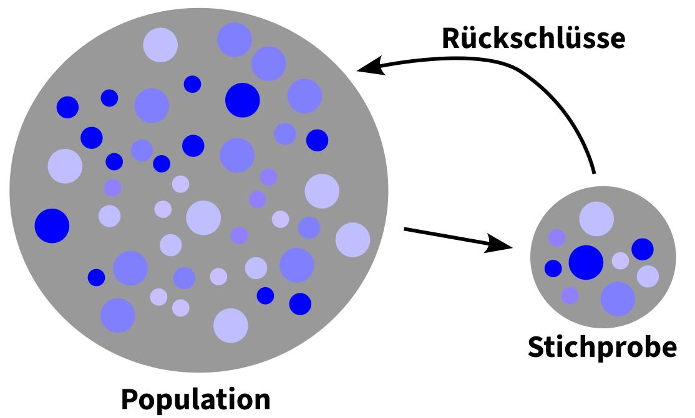
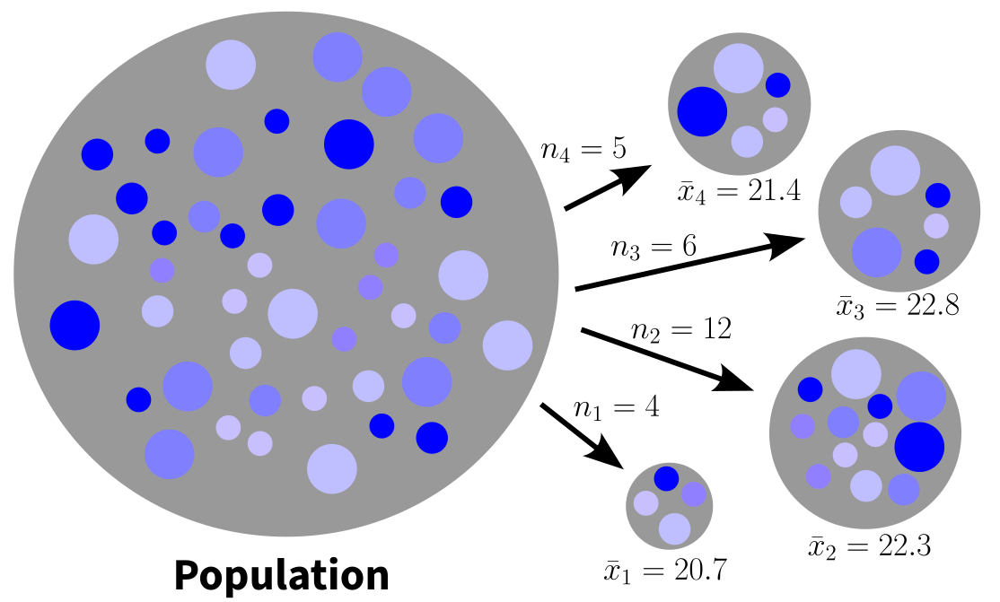
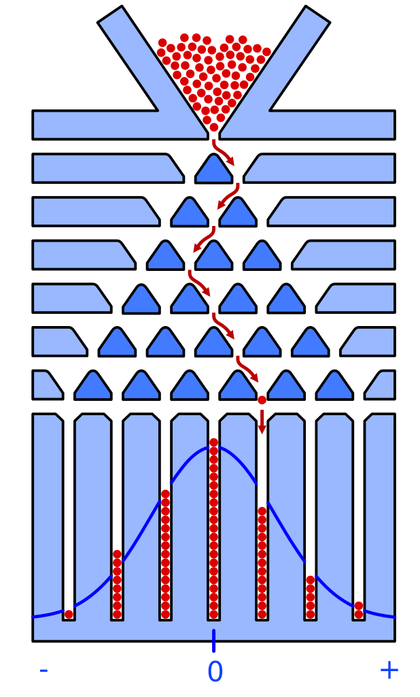

## Inhalte

- Population und Stichprobe
- Punktschätzer
- Stichprobenvariation des Mittelwerts
- Standardfehler
- Stichprobenumfang und Stichprobenvariation
- Vertrauensintervall

## Schliessende Statistik {.smaller}

:::: {.columns}

::: {.column width="30%"}
Population

- Genau definierte Gruppe von Beobachtungseinheiten
- Darüber werden Schlussfolgerungen gezogen
:::

::: {.column width="40%"}

{fig-align="center"}

:::

::: {.column width="30%"}
Stichprobe

- Auswahl von Beobachtungseinheiten in der Population
- Anzahl Beobachtungseinheiten: Stichprobenumfang
:::
::::
::: {.callout-tip}
## Merke
Die Inferenzstatistik versucht aus einer Stichprobe Aussagen über die Population (Grundgesamtheit) zu machen:

- Entscheidungen treffen mit statistischen Tests (eine neue Therapie wirkt besser)
- Schätzungen (Konfidenzintervalle)
- Vorhersagen (z.B. Regressionen, Zeitreihenmodelle)
:::

## Parameter und Schätzer {.smaller}


- **Parameter**: im allgemeinen unbekannte Kennzahlen einer Population (z.B. Mittelwert, Standardabweichung)
- **Schätzer**: Kennzahlen in der Stichprobe für die Parameter in der Population

Beispiele:

| Kennzahlen         | Parameter | Schätzer  |
|--------------------|-----------|-----------|
| Anzahl             | $N$       | $n$       |
| Mittelwert         | $\mu$     | $\bar{x}$ |
| Standardabweichung | $\sigma$  | $s$       |
| Korrelation        | $\rho$    | $r$       |

##  {.smaller}

Durchmesser $d$ von Kreisen in einer Stichprobe vom Umfang $n = 5$ gemessen:

:::: {.columns}

::: {.column width="60%"}


{fig-align="center" width=60%}

:::

::: {.column width="40%"}
| ID | $d$  |
|----|------|
| 1  | 18.5 |
| 2  | 21.0 |
| 3  | 19.8 |
| 4  | 20.8 |
| 5  | 22.5 |

:::

::::

$$
\hat{\mu} = \bar{x} = \frac{18.5+21+19.8+20.8+22.5}{5} = 20.52
$$

::: {.callout-tip}
## Merke
Das Circumflex über dem $\mu$ bedeutet, dass es sich um einen **geschätzten** Populationsmittelwert handelt.
:::

## Repräsentativität {.smaller}

- Ist ein Qualitätsmerkmal der Stichprobe
- Ist eine Voraussetzung, um auf die Population zurückschliessen
zu können.
- Zufallsstichproben: jede Beobachtungseinheit in der Population hat
die gleiche Chance, in die Stichprobe eingeschlossen zu werden
- Grosse Stichproben sind nicht zwangsläufig repräsentativ!
  - [Literary Digest (1936)](https://de.wikipedia.org/wiki/The_Literary_Digest): Umfrage bei > 10 Mio. Abonnent:innen
zum Ausgang der Präsidentenwahl. Rücklauf 2.4 Mio: 57% für
Alfred Landon (Rep), 43% für Franklin Roosevelt (Dem)
  - Effektives Wahlresultat: 62% Roosevelt, 38% Landon
  - Grund: Die Stichprobe war nicht repräsentativ für die US-
Bevölkerung -> systematische Verzerrung der
Umfrageergebnisse wegen Selection Bias

::: {.notes}
- Literary Digest: vielgelesene amerikanische Zeitschrift
- Stichprobenauswahl: registrierte Autobesitzer, Telefonverzeichnisse > nur gut situierte Haushalte
- Rücksendung davon abhängig ob man in der Oberschicht war und wie stark man an der Wahl interessiert war
- Non-response Bias
- wurde 18 Monate nach der Wahl eingestellt
:::

## Stichprobenvariation {.smaller}

:::: {.columns}

::: {.column width="60%"}

{fig-align="center" width=100%}
:::

::: {.column width="40%"}

- Jede Zufallsstichprobe ergibt einen anderen Schätzwert.
- Stichprobenvariation (engl. sampling variation)
  - Zufallsfehler durch zufällige Auswahl von Beobachtungseinheiten
  - Nicht zu verwechseln mit systematischen Fehlern (Bias)
:::

::::

::: {.callout-tip}
## Frage

Wie genau ist die Schätzung einer Kennzahl?
:::

## Beispiel

Aus einer Population werden zwei Zufallsstichproben gezogen. Folgende Kennzahlen resultieren für den BMI:

| Stichprobe | $n$ | $\bar{x}$ | $s$ |
|------------|-----|-----------|-----|
| A          | 15  | 25.3      | 4.2 |
| B          | 120 | 22.7      | 2.7 |


::: {.callout-tip}
## Frage

Welchem Mittelwert kann man mehr trauen?
:::
## Wiederholte Stichproben {.smaller}


```{r}
#| echo: false

# Packages
library(tidyverse)
library(patchwork)
library(latex2exp)
# Import data
df <- read_csv("../data/MMs.csv")
df$Farbe <- as_factor(df$Farbe)
df$ID <- as_factor(df$ID)
# Overall mean weight
m <- mean(df$Gewicht, na.rm = TRUE)
# Overall standard deviation
s <- sd(df$Gewicht, na.rm = TRUE)
# Overall N
N <- sum(!is.na(df$Gewicht))
# Overall color probabilities
prob_all <- df |>                     # keep only rows where a colour is recorded
  filter(!is.na(Farbe)) |>            
  count(Farbe, name = "n") |>         # how many times each colour occurs
  mutate(
    total    = sum(n),                 # total number of non‑NA colour observations
    prob     = n / total,              # P(colour)
    prob_not = 1 - prob                # complementary probability
  ) |>
  select(Farbe, n, prob, prob_not)
# Reshape color probabilities
prob_long <- prob_all |>
  pivot_longer(
    cols = c(prob, prob_not),
    names_to = "type",
    values_to = "value"
  ) |>
  mutate(
    type = factor(type,
                  ## levels = c("prob", "prob_not"),
                  ## labels = c("P(Farbe)", "1–P(Farbe)"))
                  levels = c("prob_not", "prob"),
                  labels = c("1–P(Farbe)", "P(Farbe)"))
  )
# Draw samples
set.seed(30)
nA <- 5 # number of items to draw for sample A
nB <- 25 # number of items to draw for sample B
nC <- 80 # number of items to draw for sample C
nsamples <- 500
samples <- 1:nsamples # number of samples to draw
sampledf <- data.frame() # data frame for samples
weightdf <- data.frame() # data frame for sample mean weights
colordf <- data.frame() # data frame for sample color proportions
for (i in samples) {
  rowsA <- sample(1:nrow(df), nA)
  rowsB <- sample(1:nrow(df), nB)
  rowsC <- sample(1:nrow(df), nC)
  dfA <- df[rowsA,]
  dfB <- df[rowsB,]
  dfC <- df[rowsC,]
  meanAdf <- data.frame(Gewicht=mean(dfA$Gewicht, na.rm = T), n=nA, sample="A")
  meanBdf <- data.frame(Gewicht=mean(dfB$Gewicht, na.rm = T), n=nB, sample="B")
  meanCdf <- data.frame(Gewicht=mean(dfC$Gewicht, na.rm = T), n=nC, sample="C")
  meandf <- bind_rows(meanAdf, meanBdf, meanCdf)
  meandf$Ziehung <- i
  dfA$Ziehung <- i
  dfA$sample <- "A"
  dfB$Ziehung <- i
  dfB$sample <- "B"
  dfC$Ziehung <- i
  dfC$sample <- "C"
  weightdf <- bind_rows(weightdf,meandf)
  sampledf <- bind_rows(sampledf,dfA,dfB,dfC)
  probA <- dfA |>                     # keep only rows where a colour is recorded
    filter(!is.na(Farbe)) |>            
    count(Farbe, name = "n") |>         # how many times each colour occurs
    mutate(
      total    = sum(n),                 # total number of non‑NA colour observations
      prob     = n / total,              # P(colour)
      prob_not = 1 - prob                # complementary probability
    ) |>
    select(Farbe, n, prob, prob_not)
  probA$n <- nA
  probA$sample <- "A"
  probB <- dfB |>                     # keep only rows where a colour is recorded
    filter(!is.na(Farbe)) |>            
    count(Farbe, name = "n") |>         # how many times each colour occurs
    mutate(
      total    = sum(n),                 # total number of non‑NA colour observations
      prob     = n / total,              # P(colour)
      prob_not = 1 - prob                # complementary probability
    ) |>
    select(Farbe, n, prob, prob_not)
  probB$n <- nB
  probB$sample <- "B"
  probC <- dfC |>                     # keep only rows where a colour is recorded
    filter(!is.na(Farbe)) |>            
    count(Farbe, name = "n") |>         # how many times each colour occurs
    mutate(
      total    = sum(n),                 # total number of non‑NA colour observations
      prob     = n / total,              # P(colour)
      prob_not = 1 - prob                # complementary probability
    ) |>
    select(Farbe, n, prob, prob_not)
  probC$n <- nC
  probC$sample <- "C"
  probdf <- bind_rows(probA,probB,probC)
  probdf$Ziehung <- i
  colordf <- bind_rows(colordf,probdf)
}
```

Population: Gewicht von $N=$ `{r} N` M&Ms sei normalverteilt mit $\mu=$ `{r} round(m, digits = 3)` g und $\sigma=$ `{r} round(s, digits = 3)` g
```{r}
#| echo: false
#| fig.align: "center"
#| fig.width: 4
#| fig.height: 4
#| out.width: "70%"

plotSampVarMean <- function(sample, n, m, se, str) {
  d <- dnorm(seq(min(sample),max(sample), by = 0.01), mean = m, sd = se)
  ggplot(data.frame(sample)) +
    geom_histogram(
      aes(x = sample, y = ..density..),
      fill = "steelblue", color = "white",
      binwidth = 0.05) +
    labs(
      title = str,
      y="",
      x="Gewicht (g)") +
    stat_function(
      fun = dnorm,
      args = list(
        mean = m,
        sd = se
      ), color = "red", size = 1) +
  theme(text = element_text(size = 16),
        axis.text.y = element_blank(),
        axis.ticks.y = element_blank())
}
tstr <- TeX(sprintf(r'($N = %.0f$, \mu= %.3f, \sigma = %.2f)', N, m, s))
plotdf <- filter(df, !is.na(df$Gewicht))
ppop <- plotSampVarMean(sample = plotdf$Gewicht,
                      n = N,
                      m = m, se = s,
                      tstr)
ppop
```
Experiment: Wir ziehen aus der Population jeweils 500 Stichproben mit den Umfängen $n=5$, $n=25$ und $n=80$.

## Wiederholte Stichproben (500x) {.smaller}

```{r}
#| echo: false
#| fig.align: "center"
#| out.width: "80%"
summarydf <- weightdf |>
  group_by(n) |>
  summarise(
    m = mean(Gewicht),
    se = sd(Gewicht)
  )
sampleA <- weightdf |>
  filter(n==nA)
sampleB <- weightdf |>
  filter(n==nB)
sampleC <- weightdf |>
  filter(n==nC)
sumA <- summarydf |>
  filter(n==nA)
sumB <- summarydf |>
  filter(n==nB)
sumC <- summarydf |>
  filter(n==nC)

strA <- TeX(sprintf(r'($n = %.0f$, \bar{x}= %.3f, SE = %.2f)', nA, sumA$m, sumA$se))
strB <- TeX(sprintf(r'($n = %.0f$, \bar{x}= %.3f, SE = %.2f)', nB, sumB$m, sumB$se))
strC <- TeX(sprintf(r'($n = %.0f$, \bar{x}= %.3f, SE = %.2f)', nC, sumC$m, sumC$se))
ymin <- 0
ymax <- 7
xmin <- 1.5
xmax <- 3
p1 <- plotSampVarMean(sample = sampleA$Gewicht,
                      n = nA,
                      m = sumA$m, se = sumA$se,
                      strA) +
  xlim(xmin, xmax) 
p2 <- plotSampVarMean(sample = sampleB$Gewicht,
                      n = nB,
                      m = sumB$m, se = sumB$se,
                      strB) +
  xlim(xmin, xmax) 
p3 <- plotSampVarMean(sample = sampleC$Gewicht,
                      n = nC,
                      m = sumC$m, se = sumC$se,
                      strC) +
  xlim(xmin, xmax) 
```
:::: {.columns}

::: {.column width="25%"}

```{r}
#| echo: false
#| fig.align: "center"
#| fig.width: 4
#| fig.height: 8
#| out.width: "90%"

p1 / p2 / p3 + plot_layout(axes = "collect")

```
:::

::: {.column width="75%"}


- Stichprobenmittelwert: in der Nähe des wahren Populationsmittelwertes, aber nicht exakt.
- Stichprobenstreuung:
  - Je grösser der Stichprobenumfang n, desto näher liegen die geschätzten Mittelwerte beim wahren Populationsmittelwert.
  - Streuung dieser Verteilungen ist **SE**: **Stichprobenfehler** in Abhängigkeit von $n$.
- Stichprobenmittelwerte der jeweils 500 Stichproben sind annähernd normalverteilt.

:::

::::
**Histogramme: Verteilung der Stichprobenmittelwerte aus jeweils 500 Stichproben im Umfang $n=5$, $n=25$ und $n=80$.**

::: {.notes}
- Jeder Stichprobenmittelwert liegt in der Nähe des wahren Populationsmittelwertes, aber es ist wenig wahrscheinlich, dass ein Stichprobenmittelwert exakt den wahren Populationsmittelwert trifft.
- Je grösser der Stichprobenumfang n, desto näher liegen die geschätzten Mittelwerte beim wahren Populationsmittelwert. Mit anderen Worten: Je grösser der Stichprobenumfang $n$ ist, desto mehr können wir dem Stichprobenmittelwert vertrauen, dass er den wahren Populationsparameter repräsentiert.
- Die Streuung dieser Verteilungen SE ist ein Mass für den Stichprobenfehler in Abhängigkeit vom Stichprobenumfang n: Grössere Stichprobenumfänge weisen einen kleineren Fehlerbereich SE auf.
- Die Stichprobenmittelwerte der jeweils 1000 Stichproben sind annähernd normalverteilt.
:::

## Zentraler Grenzwertsatz: Galtonbrett {.smaller}


:::: {.columns}

::: {.column width="40%"}

{fig-align="center" width=80%}
:::

::: {.column width="60%"}

- Zufallsexperiment im Bild: Nach rechts oder links fallen über sechs Ebenen.
- Wiederholung mit unendlich vielen Kugeln führt zu einer Normalverteilung über die Fächer.
- Praktische Beispiele: 
  - (i) Zufälliger Messfehler bei wiederholten Messungen
  - (ii) Ziehen von zufälligen Stichproben aus einer Population

::: {.callout-tip}
## Merke

- Die Mittelwerte einer genügend grossen Anzahl Zufallsexperimente sind näherungsweise normalverteilt.
- Unabhängig davon wie ein Merkmal in der Population verteilt ist.
:::
:::

::::

::: footer
[Galtonbrett Wikipedia](https://de.wikipedia.org/wiki/Galtonbrett)
:::

::: {.notes}
- Demo Galtonbrett Wikipedia
:::

## Zentraler Grenzwertsatz {.smaller}

:::: {.columns}

::: {.column width="30%"}


```{r}
#| echo: false
#| fig.align: "center"
#| fig.width: 4
#| fig.height: 8
#| out.width: "100%"
xmin <- 0.5
xmax <- 4
rectdf <- data.frame(xmin = c(m - s), xmax = c(m + s), Shading = c("Sigma"))
ppop <- ppop  +
  geom_rect(aes(xmin = xmin, xmax = xmax,
                ymin = -Inf, ymax = Inf,
                fill = Shading),
            alpha = 0.3, data = rectdf, inherit.aes = FALSE) +
  scale_fill_manual(values = c("steelblue")) +
  xlim(xmin, xmax)
rectdf <- data.frame(xmin = sumA$m - sumA$se, xmax = sumA$m + sumA$se, Shading = c("SE"))
p1 <- plotSampVarMean(sample = sampleA$Gewicht,
                      n = nA,
                      m = sumA$m, se = sumA$se,
                      strA) +
  geom_rect(aes(xmin = xmin, xmax = xmax,
                ymin = -Inf, ymax = Inf,
                fill = Shading),
            alpha = 0.3, data = rectdf, inherit.aes = FALSE) +
  scale_fill_manual(values = c("steelblue")) +
  xlim(xmin, xmax)
rectdf <- data.frame(xmin = sumB$m - sumB$se, xmax = sumB$m + sumB$se, Shading = c("SE"))
p2 <- plotSampVarMean(sample = sampleB$Gewicht,
                      n = nB,
                      m = sumB$m, se = sumB$se,
                      strB) +
  geom_rect(aes(xmin = xmin, xmax = xmax,
                ymin = -Inf, ymax = Inf,
                fill = Shading),
            alpha = 0.3, data = rectdf, inherit.aes = FALSE) +
  scale_fill_manual(values = c("steelblue")) +
  xlim(xmin, xmax)
rectdf <- data.frame(xmin = sumC$m - sumC$se, xmax = sumC$m + sumC$se, Shading = c("SE"))
p3 <- plotSampVarMean(sample = sampleC$Gewicht,
                      n = nC,
                      m = sumC$m, se = sumC$se,
                      strC) +
  geom_rect(aes(xmin = xmin, xmax = xmax,
                ymin = -Inf, ymax = Inf,
                fill = Shading),
            alpha = 0.3, data = rectdf, inherit.aes = FALSE) +
  scale_fill_manual(values = c("steelblue")) +
  xlim(xmin, xmax)
ppop / p1 / p2 / p3 + plot_layout(axes = "collect")
```
:::

::: {.column width="70%"}

Englisch: Central Limit Theorem (CLT)

> Die Verteilung von Mittelwerten aus Stichproben der Grösse $n$ aus einer Population mit Mittelwert $\mu$ und Standardabweichung $\sigma$ nähert sich mit zunehmendem $n$ einer Normalverteilung mit dem Mittelwert $\mu$ und der Standardabweichung $SE = \frac{\sigma}{\sqrt{n}}$.
>
> Dies ist unabhängig davon, wie das Merkmal in der Population verteilt ist.
:::

::::
## Standardfehler  {.smaller}

:::: {.columns}

::: {.column width="30%"}


```{r}
#| echo: false
#| fig.align: "center"
#| fig.width: 4
#| fig.height: 8
#| out.width: "100%"
ppop / p1 / p2 / p3 + plot_layout(axes = "collect")
```
:::

::: {.column width="70%"}

Englisch: standard error, SE

$$
SE = \frac{s}{\sqrt{n}} \approx \frac{\sigma}{\sqrt{n}}
$$

- Mass dafür, wie stark eine beobachtete Stichprobenkennzahl im Durchschnitt vom wahren Parameter der Grundgesamtheit abweicht.
- Beschreibt, wie stark sich verschiedene Stichprobenmittelwerte aus der gleichen Grundgesamtheit unterscheiden.
- Ein Mass für die Stichprobenvariation.

:::

::::

::: footer
[Central Limit Theorem for Means](https://gallery.shinyapps.io/CLT_mean/)
:::

## Beispiel {.smaller}

Aus einer Population werden zwei Zufallsstichproben gezogen. Folgende Kennzahlen resultieren für den BMI:

| Stichprobe | $n$ | $\bar{x}$ | $s$ | $SE$                            |
|------------|-----|-----------|-----|---------------------------------|
| A          | 15  | 25.3      | 4.2 | $\frac{4.2}{\sqrt{15}} = 1.08$  |
| B          | 120 | 22.7      | 2.7 | $\frac{2.7}{\sqrt{120}} = 0.25$ |

Welchem Mittelwert kann man mehr trauen?

::: {.callout-tip}
## Frage

Welchem Mittelwert kann man mehr trauen?

Die Stichprobe B hat einen grösseren Umfang und eine kleinere Standardabweichung: Schätzer für den Populationsmittelwert aus dieser Stichprobe ist weniger fehlerbehaftet (SE ist kleiner).

:::

## Punkt- und Intervallschätzer {.smaller}


:::: {.columns}

::: {.column width="60%"}

{fig-align="center" width=100%}
:::

::: {.column width="40%"}

- Jede Zufallsstichprobe ergibt einen anderen Schätzwert
- Punktschätzer entspricht sehr selten dem wahren Wert 

:::

::::

::: {.callout-tip}
## Intervallschätzung

Angabe eines Wertebereiches in dem die Populationskennzahl mit einer bestimmten Wahrscheinlichkeit liegt.
:::

::: {.notes}
- Bisher: Punkt-Schätzer (eine Zahl), Beispiel: Mittelwert
  - Schwäche: Wir können nicht wissen, ob die aus der Stichprobe berechnete Kennzahl ein guter Schätzer für die Populationskennzahl ist;
  - d.h. wir wissen nicht, wie gut wir dem Schätzer vertrauen können.
- Zuverlässiger
  - Angabe eines Wertebreiches in dem die Populationskennzahl mit einer bestimmten Vertrauenswahrscheinlichkeit liegt
:::

## Konfidenzintervall {.smaller}

```{r}
#| echo: false
#| fig.align: "center"
#| fig.width: 5
#| fig.height: 3
#| out.width: "90%"
plotdf <- sampledf |>
  filter(Ziehung <= 10 & sample == "A")
pci <- plotdf |> 
  ggplot(aes(x=Ziehung,y=Gewicht)) +
  stat_summary(fun.data = "mean_cl_normal") +
  geom_hline(yintercept = m, size=1.5, color="blue") +
  labs(y="Gewicht (g)", x="Ziehung",
       title = paste("N = ",nA,"; Mean and 95% CI")) +
  coord_flip(ylim=c(min(df$Gewicht),max(df$Gewicht)))
pci
```

- Angabe einer unteren und oberen Grenze unter Berücksichtigung der Stichprobenvariation
- Glaubhafter Bereich für die wahre Kennzahl in der Population
- Man möchte, dass $(1-\alpha)$% aller Konfidenzintervalle den wahren Wert beinhalten
- $(1-\alpha)$ bezeichnet man als Vertrauenswahrscheinlichkeit
- Üblich: $\alpha = 0.05$ => $(1-0.05) = 0.95$ (95%)

## 95% Konfidenzintervall {.smaller}

:::: {.columns}

::: {.column width="70%"}

```{r}
#| echo: false
#| fig.align: "center"
#| out.width: "80%"

pregel <- ggplot(data.frame(x = c(-4, 4)), aes(x)) +
  stat_function(fun = dnorm,
                geom = "line",
                xlim = c(-4, 4)) +
  stat_function(fun = dnorm,
                geom = "area",
                fill = "steelblue",
                alpha = .2,
                xlim = c(-3, 3)) +
  stat_function(fun = dnorm,
                geom = "area",
                fill = "steelblue",
                alpha = .5,
                xlim = c(-2, 2)) +
  stat_function(fun = dnorm,
                geom = "area",
                fill = "steelblue",
                alpha = 1,
                xlim = c(-1, 1)) +
  stat_function(fun = dnorm,
                geom = "line",
                xlim = c(-4, 4)) +
  xlim(-4, 4) +
  theme_grey() +
  xlab("") +
  ylab("") +
  scale_x_continuous(breaks = c(-3, -2, -1, 0, 1, 2, 3),
                     labels = expression(mu - 3 * sigma,
                     mu - 2 * sigma,
                     mu - sigma,
                     mu,
                     mu + sigma,
                     mu + 2 * sigma,
                     mu + 3 * sigma)) +
  theme(axis.text.y = element_blank(),
        axis.ticks.y = element_blank(),
        text = element_text(size = 24))

pregel <- pregel + 
  annotate("segment", x = -1, xend = 1, y = .13, yend = .13,
           arrow = arrow(ends = "both", angle = 90)) +
  annotate("segment", x = -2, xend = 2, y = .08, yend = .08,
           arrow = arrow(ends = "both", angle = 90)) +
  annotate("segment", x = -3, xend = 3, y = .03, yend = .03,
           arrow = arrow(ends = "both", angle = 90)) +
  annotate("text", x = 0, y = .05, label = "99.7%", size = 8) +
  annotate("text", x = 0, y = .1, label = "95%", size = 8) +
  annotate("text", x = 0, y = .15, label = "68%", size = 8)
pregel
```

:::

::: {.column width="30%"}


| Bereich              | Fläche |
|----------------------|--------|
| $\mu\pm 1 \sigma$    | 68.3%  |
| $\mu\pm 1.96 \sigma$ | 95.0%  |
| $\mu\pm 2 \sigma$    | 95.5%  |
| $\mu\pm 3 \sigma$    | 99.7%  |

:::
::::

::: {.callout-tip}
## Merke

$$
CI_{95} = \bar{x} \pm 1.96 \cdot SE = \bar{x} \pm 1.96 \cdot \frac{s}{\sqrt{n}}
$$
:::

## Interpretation Konfidenzintervall {.smaller}

:::: {.columns}

::: {.column width="20%"}

```{r}
#| echo: false
#| fig.align: "center"
#| fig.width: 2
#| fig.height: 5
#| out.width: "90%"
plotdf <- sampledf |>
  filter(Ziehung <= 20 & sample == "A")

df_flag <- plotdf |>
  group_by(Ziehung) |>
  summarise(
    # calculate CI limits (mean_cl_normal returns a data.frame)
    ci = list(mean_cl_normal(Gewicht)),
    .groups = "drop"
  ) |>
  # expand the list‑column into separate columns
  mutate(
    ymin = map_dbl(ci, "ymin"),
    ymax = map_dbl(ci, "ymax"),
    flag = ymin <= m & ymax >= m # TRUE = CI contains µpop
  ) |>
  select(Ziehung, flag)
plotdf <- plotdf |> left_join(df_flag, by = "Ziehung")

pci <- plotdf |> 
  ggplot(aes(x=Ziehung,y=Gewicht)) +
  stat_summary(
    fun.data = "mean_cl_normal",
    geom = "pointrange",
    aes(colour = flag),
    size = 0.3) +
  scale_colour_manual(
    name = "Contains µpop?",    # friendly title
    values = c(`TRUE` = "black", `FALSE` = "red"),
    labels = c(`TRUE` = "Yes", `FALSE` = "No")
  ) +
  geom_hline(yintercept = m, size=1, color="blue") +
  labs(y="Gewicht (g)", x="Ziehung",
       title = paste("n = ",nA)) +
  coord_flip(ylim=c(min(df$Gewicht),max(df$Gewicht))) +
  theme(legend.position = "none")
pci
```
:::

::: {.column width="80%"}

- Für 95%-Konfidenzintervalle: wenn man 100 Zufallsstichproben aus der selben Population zieht, dann beinhalten im Durchschnitt 95 Konfidenzintervalle den wahren Populationsmittelwert.
- Bei 20 Ziehungen würde man $0.95 \cdot 20 = 19$ Konfidenzintervalle erwarten, welche den wahren Populationsmittelwert beinhalten.
- Im vorliegenden Fall sind es nur 17 (85%)
- Bei einer grossen Anzahl Wiederholungen würde sich die Fehlerrate bei 5% einstellen

::: {.callout-tip}
## Korrekte Interpretation

Man kann zu 95% darauf vertrauen, dass der wahre Populationsmittelwert zwischen ... und ... liegt.

:::

:::
::::

::: {.notes}
- Nur 17 Konfidenzintervalle beinhalten den wahren Populationsmittelwert 85% > zu berücksichtigen, dass das Experiment nur 20 mal wiederholt wurde > würde sich bei 5% einpendeln mit vielen Wiederholungen
:::

## Häufige Fehlinterpretationen {.smaller}

:::: {.columns}

::: {.column width="20%"}

```{r}
#| echo: false
#| fig.align: "center"
#| fig.width: 2
#| fig.height: 5
#| out.width: "90%"
pci
```
:::

::: {.column width="80%"}

::: {.callout-tip}
## Korrekte Interpretation

Man kann zu 95% darauf vertrauen, dass der wahre Populationsmittelwert zwischen ... und ... liegt.

:::

::: {.callout-warning}

- Das einzelne Konfidenzintervall enthält den Populationsparameter oder nicht, aber wir können zu XX% darauf vertrauen.
- Es bedeutet **nicht**, dass sich der wahre Populationsmittelwert mit einer Wahrscheinlichkeit von 95% im Konfidenzintervall befindet.
- Wenn man betont, dass es sich um eine frequentistische Wahrscheinlichkeit ("on the long run") handelt, dann ist die Aussage korrekt
- Es bedeutet **nicht**, dass 95% aller Daten der Stichprobe oder der Population darin liegen: Konfidenzintervalle beziehen sich immer auf einen unbekannten Parameter in der Population.
:::

:::
::::

::: {.notes}

:::

## Einflüsse auf das Konfidenzintervall {.smaller}

:::: {.columns}

::: {.column width="40%"}

```{r}
#| echo: false
#| fig.align: "center"
#| fig.width: 4
#| fig.height: 5
#| out.width: "90%"

ymin <- 1
ymax <- 4
plotdf <- sampledf |>
  filter(Ziehung <= 20 & sample == "A")
df_flag <- plotdf |>
  group_by(Ziehung) |>
  summarise(
    # calculate CI limits (mean_cl_normal returns a data.frame)
    ci = list(mean_cl_normal(Gewicht)),
    .groups = "drop"
  ) |>
  # expand the list‑column into separate columns
  mutate(
    ymin = map_dbl(ci, "ymin"),
    ymax = map_dbl(ci, "ymax"),
    flag = ymin <= m & ymax >= m # TRUE = CI contains µpop
  ) |>
  select(Ziehung, flag)
plotdf <- plotdf |> left_join(df_flag, by = "Ziehung")

pci5 <- plotdf |> 
  ggplot(aes(x=Ziehung,y=Gewicht)) +
  stat_summary(
    fun.data = "mean_cl_normal",
    geom = "pointrange",
    aes(colour = flag),
    size = 0.3) +
  scale_colour_manual(
    name = "Contains µpop?",    # friendly title
    values = c(`TRUE` = "black", `FALSE` = "red"),
    labels = c(`TRUE` = "Yes", `FALSE` = "No")
  ) +
  geom_hline(yintercept = m, size=1, color="blue") +
  labs(y="Gewicht (g)", x="Ziehung",
       title = paste("n = ",nA)) +
  coord_flip(ylim=c(ymin,ymax)) +
  theme(legend.position = "none")

plotdf <- sampledf |>
  filter(Ziehung <= 20 & sample == "B")
df_flag <- plotdf |>
  group_by(Ziehung) |>
  summarise(
    # calculate CI limits (mean_cl_normal returns a data.frame)
    ci = list(mean_cl_normal(Gewicht)),
    .groups = "drop"
  ) |>
  # expand the list‑column into separate columns
  mutate(
    ymin = map_dbl(ci, "ymin"),
    ymax = map_dbl(ci, "ymax"),
    flag = ymin <= m & ymax >= m # TRUE = CI contains µpop
  ) |>
  select(Ziehung, flag)
plotdf <- plotdf |> left_join(df_flag, by = "Ziehung")
pci25 <- plotdf |> 
  ggplot(aes(x=Ziehung,y=Gewicht)) +
  stat_summary(
    fun.data = "mean_cl_normal",
    geom = "pointrange",
    aes(colour = flag),
    size = 0.3) +
  scale_colour_manual(
    name = "Contains µpop?",    # friendly title
    values = c(`TRUE` = "black", `FALSE` = "red"),
    labels = c(`TRUE` = "Yes", `FALSE` = "No")
  ) +
  geom_hline(yintercept = m, size=1, color="blue") +
  labs(y="Gewicht (g)", x="Ziehung",
       title = paste("n = ",nB)) +
  coord_flip(ylim=c(ymin,ymax)) +
  theme(legend.position = "none")
(pci5 | pci25) + plot_layout(axis_titles = "collect")
```
:::

::: {.column width="60%"}

$$
CI_{95} = \bar{x} \pm 1.96 \cdot SE = \bar{x} \pm 1.96 \cdot \frac{s}{\sqrt{n}}
$$

Das Konfidenzintervall wird schmaler falls:

- der Stichprobenumfang $n$ grösser wird
- die Streuung der Daten $s$ in der Stichprobe kleiner wird
- die Vertrauenswahrscheinlichkeit $(1-\alpha)$ kleiner wird
:::
::::

## Beispiel {.smaller}

Aus einer Population werden zwei Zufallsstichproben gezogen. Folgende Kennzahlen resultieren für den BMI:

| Stichprobe | $n$ | $\bar{x}$ | $s$ | $SE$                            |
|------------|-----|-----------|-----|---------------------------------|
| A          | 15  | 25.3      | 4.2 | $\frac{4.2}{\sqrt{15}} = 1.08$  |
| B          | 120 | 22.7      | 2.7 | $\frac{2.7}{\sqrt{120}} = 0.25$ |


| Stichprobe | CI unten                         | CI oben                          |
|------------|----------------------------------|----------------------------------|
| A          | $25.3 - 1.96 \cdot 1.08 = 23.18$ | $25.3 + 1.96 \cdot 1.08 = 27.42$ |
| B          | $22.7 - 1.96 \cdot 0.25 = 22.21$ | $22.7 + 1.96 \cdot 0.25 = 23.19$ |

$$
CI_{95} = \bar{x} \pm 1.96 \cdot SE = \bar{x} \pm 1.96 \cdot \frac{s}{\sqrt{n}}
$$

## Zusammenfassung {.smaller}

:::: {.columns}

::: {.column width="40%"}

{fig-align="center"}

{fig-align="center" width=100%}
:::

::: {.column width="60%"}

- In der Inferenzstatistik schliesst man von der Stichprobe auf die Population
- Mit Stichprobenkennzahlen werden Populationsparameter geschätzt
- Stichprobenkennzahlen variieren von Stichprobe zu Stichprobe
- Die Stichprobenvariation nimmt mit zunehmender Stichprobengrösse ab (Standardfehler wird kleiner)
- Der Standardfehler ist ein Mass für die Stichprobenvariation
- Ein Konfidenzintervall gibt den plausiblen Bereich eines Populationsparameters wieder

:::
::::
