## Inhalte

- Hypothesen
- Statistischer Test
- Signifikanz und p-Wert
- Entscheidungsfehler
- Vergleich Mittelwert einer Stichprobe mit Referenz
- Vergleich Mittelwerte von zwei Stichproben

## Angewandte Fragestellung {.smaller}

:::: {.columns}

::: {.column width="30%"}

{fig-align="center" width=100%}
:::

::: {.column width="70%"}

**Frage**: Unterscheidet sich die Körpergrösse zwischen Männern und Frauen?

**Wissenschaftliche Hypothese**: Die Körpergrösse von Männern und Frauen ist unterschiedlich.

::: {.callout-caution}
## Achtung
Es ist wissenschaftlich nicht redlich, zuerst die Daten zu erheben und erst dann die Hypothesen aufzustellen!
:::

:::

::::

::: {.notes}
- Ausgangspunkt ist eine wissenschaftliche Fragestellung.
- Dazu folgt eine Behauptung, die man mit Hilfe von Daten und statistischen Methoden untersuchen möchte.
:::

## Präzisierung {.smaller}

:::: {.columns}

::: {.column width="30%"}

{fig-align="center" width=100%}
:::

::: {.column width="70%"}

**Statistische Hypothese**: Der Mittelwert der Körpergrösse von Männern und Frauen ist unterschiedlich.

$$
\mu_w \neq \mu_m 
$$

::: {.callout-caution}
## Achtung

Wir schreiben nicht

$$
\bar{x}_w \neq \bar{x}_m
$$

da sich die Hypothese auf die Population und nicht die Stichprobe bezieht!
:::

:::

::::

::: {.notes}
- Eine statistische Hypothese ist eine Hypothese in Bezug auf einen oder mehrere Populationsparameter (z.B. Mittelwert, Median, Standardabweichung etc.).
- Häufiger Fehler: Formulierung der Hypothese in Bezug auf die Stichprobenkennzahlen an Stelle der Populationsparameter. (Wir brauchen keine Hypothese z.B. zum Mittelwert unserer Stichprobe, weil wir diesen ja kennen)
:::

## Statistische Hypothesen {.smaller}

Nullhypothese $H_0$

- Gegenteil der wissenschaftlichen Hypothese und Behauptung die man ablehnen möchte.
- Annahme: Unterschiede, die man in der Stichprobe beobachtet, sind lediglich durch Stichprobenvariation (zufällig) entstanden.

$$
H_0: \mu_w = \mu_m
$$

Alternativhypothese $H_A$ (oft auch $H_1$) - wissenschaftliche Hypothese

- Enthält in der Regel die Motivation eines Experimentes. 

$$
H_A: \mu_w \neq \mu_m
$$

## Daten erheben {.smaller}

```{r}
library(tidyverse)
library(kableExtra)
library(rio)
library(patchwork)
library(table1)
df.stud <- import("../data/01-physio.csv")
df.stud <- df.stud |>
    mutate(
        Kohorte = extract_numeric(Kohorte),
        Groesse = as.numeric(Groesse),
        Gewicht = as.numeric(Gewicht),
        Geschwister = as.integer(sample(0:4, nrow(df.stud), prob = c(0.2, 0.3, 0.3, 0.1, 0.1), replace = TRUE)),
        Kohorte = as.factor(Kohorte),
        Geschlecht = as.factor(Geschlecht),
        Augenfarbe = as.factor(Augenfarbe),
        Klasse = as.factor(Klasse)
    )
df.stud_w <- df.stud |>
    filter(Geschlecht == "w")
plt <- ggplot(df.stud, mapping = aes(x = Geschlecht, y = Groesse)) +
    geom_boxplot(outlier.shape = 8, outlier.size = 3, outlier.color = "red") +
    ## geom_jitter(position = position_jitter(0.2), size=3) +
    labs(y = "Körpergrösse (cm)", x = "") +
    theme(text = element_text(size = 22))
```

```{r}
#| out.width: "100%"
#| fig.align: "center"
plt 
```

```{r}
#| out.width: "60%"
tbl <- table1(~Gewicht | Geschlecht,
              data = df.stud,
              overall = FALSE)
t1kable(tbl)
```

::: {.notes}
- Passend zu den formulierten Hypothesen entwickelt man ein Versuchsdesign.
- Möglichst viele Einflussgrössen die einem nicht interessieren konstant halten.
  - Ermüdungsstatus zum Messzeitpunkt
  - Akute Infekte zum Messzeitpunkt
- Ist dies nicht möglich, so muss man solche Störgrössen im Design und bei der
Auswertung beachten.
- Stichprobengrösse hängt von verschiedenen Faktoren ab:
  - der Streuung der Daten
  - dem relevanten Unterschied
  - dem statistischen Test der benützt wird
  - dem Signifikanzniveau
  - der Power
Ebenfalls müssen ökonomische Faktoren berücksichtigt werden, da Studien mit
hohen Fallzahlen teuer sind.
- Wenn man Daten erhoben hat:
  - visualisieren
  - Kennzahlen berechnen
  - Statistische Tests durchführen
:::

## Prinzip

Wir nehmen an, die Nullhypothese stimmt (es gibt keinen Unterschied):

> Wie gross ist dann die Wahrscheinlichkeit, eine so grosse Differenz (oder noch grössere) zu erhalten wie in unserer Stichprobe?

Oder anders: Wie *extrem* sind unsere Daten unter der Annahme, dass die Nullhypothese stimmt?

## Teststatistik {.smaller}

Um den statistischen Test durchzuführen, muss zunächst die sogenannte **Teststatistik** aus den Daten berechnet werden.

$$
\text{Teststatistik} = \frac{\text{Durch Modell erklärte Varianz}}{\text{Durch Modell nicht erklärte Varianz}} = \frac{\text{Effekt}}{\text{Fehler}}
$$

Im Falle des t-Tests zum Vergleich von Mittelwerten

$$
t = \frac{\text{Differenz zw. Gruppenmittelwerten}}{\text{Standardfehler}}
$$

::: {.callout-important}
## Merke

$t$ wird grösser falls:

- Die Differenz, d.h. der Effekt, grösser wird.
- Der Standardfehler kleiner wird: Stichprobenstreuung wird kleiner und/oder der Stichprobenumfang wird grösser.

:::

## Exkurs: t-Verteilung und t-Wert {.smaller}


::: {.columns}

::: {.column width="50%"}

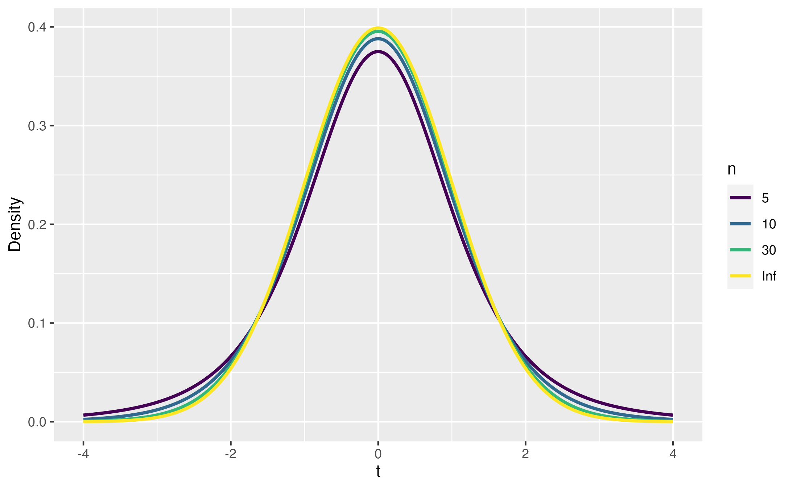{fig-align="center" width=80%}

:::

::: {.column width="50%"}

- Beim Schätzen von Mittelwerten in normalverteilten Populationen.
- Wenn Stichproben klein sind.
- Wenn die Populations-Standardabweichung nicht bekannt ist.

:::

:::

$$
t = \frac{\text{Differenz zw. Gruppenmittelwerten}}{\text{Standardfehler}} = \frac{d}{SE} = \frac{d}{\frac{SD}{\sqrt{n}}}
$$

::: {.callout-important}
## Merke

Wenn t-Verteilung vorliegt müssen auf der x-Achse andere Werte gewählt werden als bei Normalverteilung um die 95%-Fläche zu berechnen.

:::

## Exkurs: t-Verteilung und t-Wert (cont.) {.smaller}

::: {.columns}

::: {.column width="50%"}

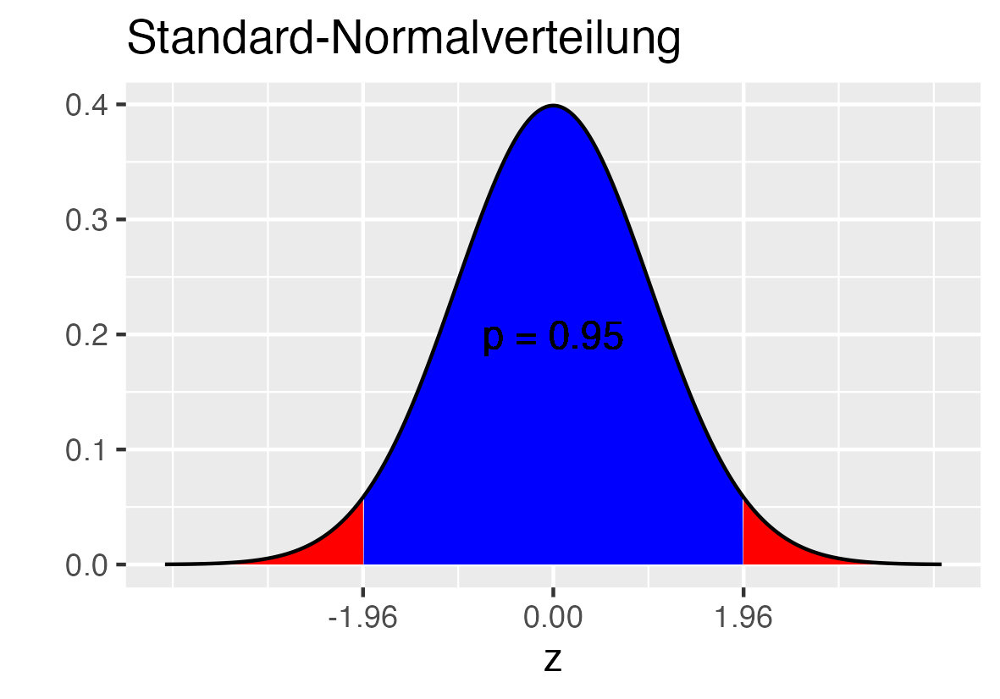{fig-align="center" width=100%}

$$
CI = \bar{x} \pm 1.96 \cdot SE
$$

:::

::: {.column width="50%"}

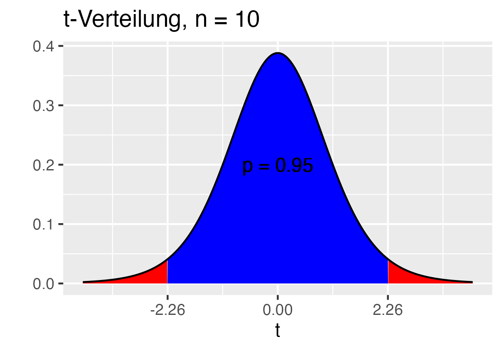{fig-align="center" width=100%}

$$
CI = \bar{x} \pm  2.26 \cdot SE
$$

:::

:::

## p-Wert {.smaller}

::: {.columns}

::: {.column width="60%"}

- *p-Wert*: die Wahrscheinlichkeit, dass der beobachtete Wert der Teststatistik oder noch extremer unter der Nullhypothese vorkommen kann.
- Ist diese Wahrscheinlichkeit genügend klein, so ist die Nullhypothese nicht plausibel.
- Übliche Grenze (Signifikanzniveau) 5%.

$$
t_{\text{Obs}} = \frac{d}{SE}
$$
:::

::: {.column width="40%"}

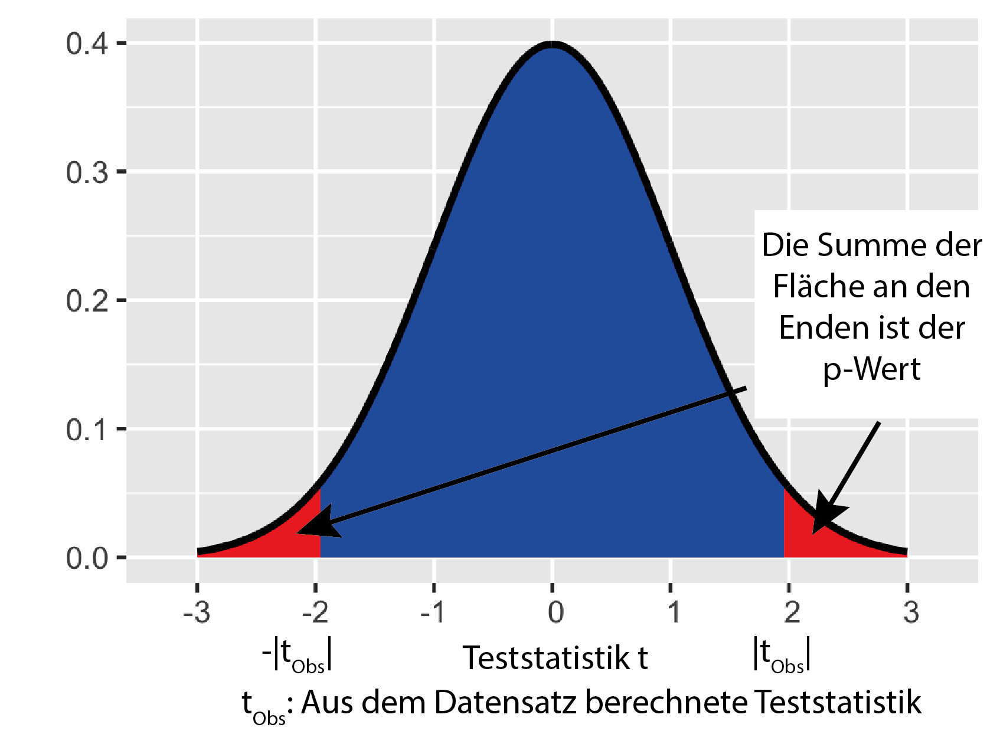{fig-align="center" width=100%}

:::

:::

::: {.callout-important}
## Merke

Die Nullhypothese wird abgelehnt wenn der beobachtete t-Wert $t_{\text{Obs}}$ den dem Signifikanzniveau zugehörigen kritischen t-Wert $t_{\text{Crit}}$ überschreitet.

:::

::: {.notes}

- Man betrachtet dann also eine Nullhypothese gerade noch als plausibel, wenn sie in 5% der Fälle zufällig zu einer extremeren Teststatistik führen würde.
- Wert zwischen 0 und 1

:::

## Entscheid {.smaller}

:::: {.columns}

::: {.column width="30%"}

{fig-align="center" width=100%}
:::

::: {.column width="70%"}

**p-Wert kleiner als Signifikanzniveau: $H_0$ verwerfen**

- Also $|t_{\text{Obs}}| > |t_{\text{Crit}}|$
- Signifikante Abweichungen von der Nullhypothese => man geht davon aus, dass $H_A$ gilt.

**p-Wert nicht kleiner als Signifikanzniveau: $H_0$ nicht verwerfen**

- Die Nullhypothese ist plausibel und wird beibehalten.
- Dies berechtigt aber nicht zur Behauptung, dass $H_A$ falsch ist!

:::

::::

## Beispiel Körpergrösse {.smaller}

```{r}
#| fig.align: "center"
plt 
```

```{r}
library(jmv)
tres <- ttestIS(formula = Gewicht ~ Geschlecht,
        meanDiff = TRUE,
        ci = TRUE,
        data = df.stud)
# tres
tresdf <- tres$ttest$asDF
# tresdf |>
#   kableExtra::kable()
outdf <- data.frame(
  t = round(tresdf$`stat[stud]`, digits = 2),
  p = tresdf$`p[stud]`,
  Differenz = round(tresdf$`md[stud]`, digits = 2),
  CIlower = round(tresdf$`cil[stud]`, digits = 2),
  CIupper = round(tresdf$`ciu[stud]`, digits = 2))
if (outdf$p < 0.001) {
 outdf$p = "<0.001" 
}
outdf |>
  kableExtra::kable()
```

- Die Wahrscheinlichkeit, eine Teststatistik so gross wie t oder noch extremer zu erhalten ist kleiner als 0.1%, falls die Nullhypothese wahr ist
- Falls die Nullhypothese wahr ist, dann würde die Stichprobenvariation in 100 identischen Studien lediglich <0.1% eine Teststatistik ergeben, die mindestens so weit weg vom Nullwert ist wie t.

::: {.notes}
- t-Wert: Die Differenz beträgt 11 mal den Standardfehler
- Die Wahrscheinlichkeit, eine Teststatistik so gross wie t oder noch extremer zu erhalten ist kleiner als 0.1%, falls die Nullhypothese wahr ist
- Falls die Nullhypothese wahr ist, dann würde die Stichprobenvariation in 100 identischen Studien lediglich <0.1% eine Teststatistik ergeben, die mindestens so weit weg vom Nullwert ist wie t.
- p-Wert erlaubt keine Aussage über die Richtung des Effekts.
:::

## p-Wert: Fehlinterpretation {.smaller}

Der p-Wert ist **nicht**

- die Wahrscheinlichkeit, dass die Nullhypothese stimmt
- die Wahrscheinlichkeit, dass die Alternativhypothese falsch ist
- die Wahrscheinlichkeit, dass das Ergebnis nur durch Zufall entstanden ist
- eine Quantifizierung der (klinischen) Relevanz der Ergebnisse
- eine Abschätzugn dafür, wie verlässlich die Ergebnisse sind

**Der p-Wert ist keine Interpretation, er braucht Interpretation.**

::: footer

- [M. Baker, “Statisticians issue warning over misuse of p values,” vol. 531, pp. 151–151, 2016.](https://doi.org/10.1038/nature.2016.19503) 
- [https://www.horizonte-magazin.ch/2019/03/07/braucht-es-den-statistischen-schwellenwert-noch/](https://www.horizonte-magazin.ch/2019/03/07/braucht-es-den-statistischen-schwellenwert-noch/) 
- [https://www.nzz.ch/karriere/studentenleben/der-problem-wert-ld.133818](https://www.nzz.ch/karriere/studentenleben/der-problem-wert-ld.133818) 

:::

::: {.notes}
- je kleiner p, desto unwahrscheinlicher ist es ein Stichprobenresultat per Zufall zu erhalten 
:::

## Entscheid und Irrtum {.smaller}

:::: {.columns}

::: {.column width="30%"}

{fig-align="center" width=100%}
:::

::: {.column width="70%"}

| Entscheid             | H0 wahr - nicht unterschiedlich                                        | H1 wahr - unterschiedlich                                                  |
|-----------------------|------------------------------------------------------------------------|----------------------------------------------------------------------------|
| Nicht unterschiedlich | Korrekter Entscheid <br> Häufigkeit $1-\alpha$ <br> True Negative Spezifität   | Inkorrekter Entscheid <br>Häufigkeit $\beta$ <br>False Negative <br>Typ 2 Fehler       |
| Unterschiedlich       | Inkorrekter Entscheid <br>Häufigkeit $\alpha$ <br>False Positive  <br>Typ 1 Fehler | Korrekter Entscheid <br>Häufigkeit $1-\beta$ <br>True Positive <br>Sensitivity (Power) |

:::

::::

::: {.notes}
- Fehler 1. Art
  - Falls die Nullhypothese wahr ist und der p-Wert kleiner als das Signifikanzniveau ist, wird fälschlicherweise die Alternativhypothese angenommen.
  - Diese Fehlentscheidung nenn man Fehler 1. Art.
  - Die Wahrscheinlichkeit eines Fehlers 1. Art nennt man $\alpha$-Fehler.
  - Dieser Fehler kann kontrolliert werden, er entspricht dem gewählten Signifikanzniveau
- Fehler 2. Art
  - Falls die Alternativhypothese wahr ist und der p-Wert grösser als das Signifikanzniveau ist, wird fälschlicherweise die Nullhypothese beibehalten.
  - Diese Fehlentscheidung nenn man Fehler 2. Art.
  - Die Wahrscheinlichkeit eines Fehlers 2. Art nennt man $\beta$-Fehler.
  - Dieser Fehler kann mit der passenden Wahl des Stichprobenumfangs kontrolliert werden.
:::


## Power: Stichprobenumfang, Streuung und Differenzen {.smaller}

Die Power, Macht oder Güte eines Tests, ist die Wahrscheinlichkeit, bei wahrer Alternativhypothese die Nullhypothese zu verwerfen, und ist:

$$
\gamma = 1-\beta
$$


::: {.callout-important}
## Merke
- Power wird grösser wenn...
  - Die Stichproben grösser sind.
  - Die Streuungen der Stichproben kleiner sind.
  - Die Differenz zwischen den Stichproben grösser ist.
:::

## Beispiel Fehler 2. Art n = 5 {.smaller}

:::: {.columns}

::: {.column width="50%"}

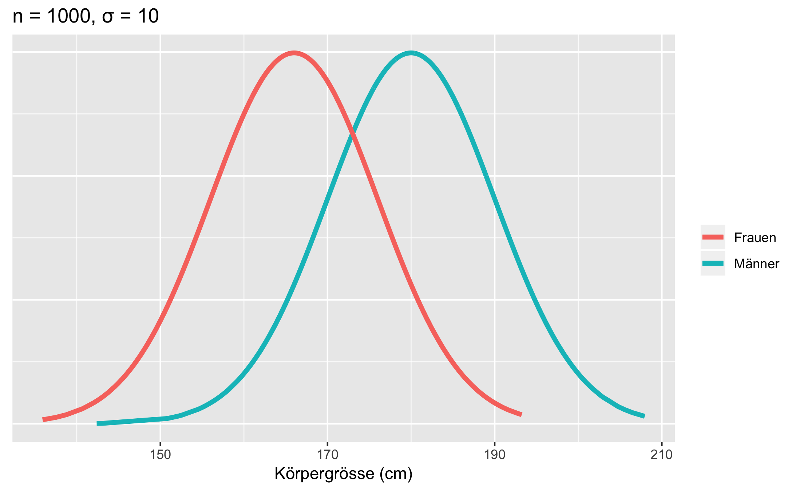{fig-align="center" width=80%}
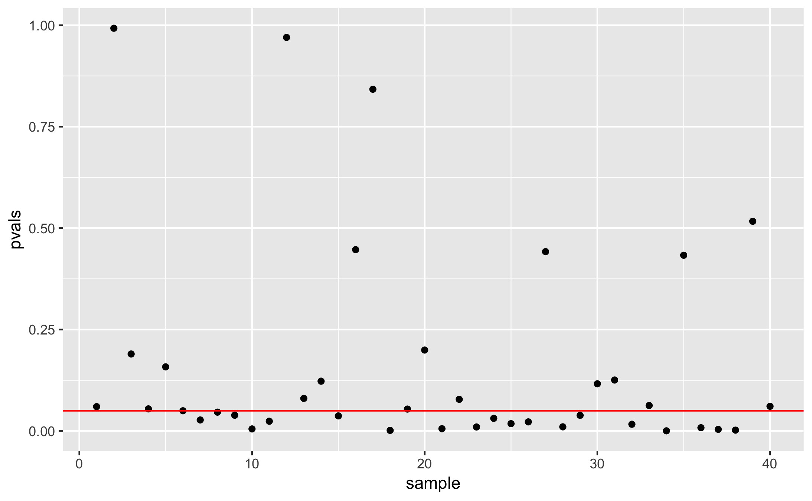{fig-align="center" width=80%}
:::

::: {.column width="50%"}

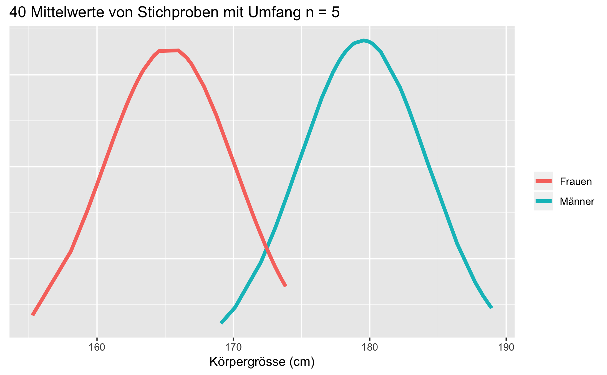{fig-align="center" width=100%}

- Theoretische Power: 0.495
- True (+): 19 / False (-): 21
- $(1-\beta) = \frac{19}{40} = 0.475$

:::

::::

## Beispiel Fehler 2. Art n = 10 {.smaller}

:::: {.columns}

::: {.column width="50%"}

{fig-align="center" width=80%}
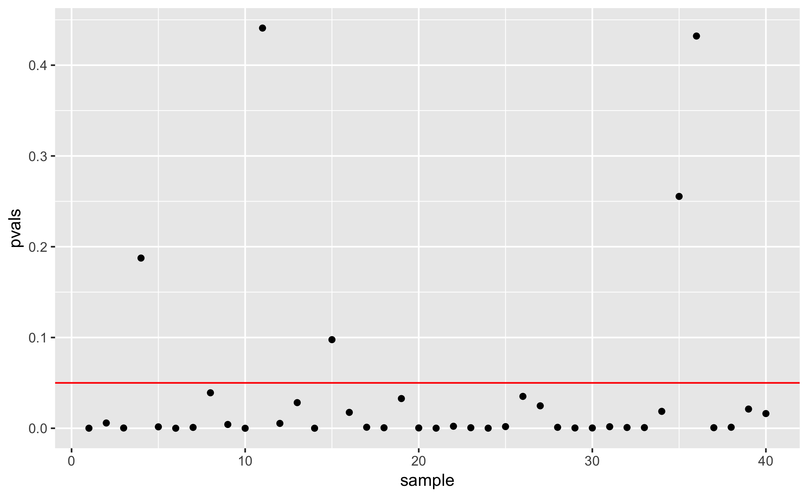{fig-align="center" width=80%}
:::

::: {.column width="50%"}

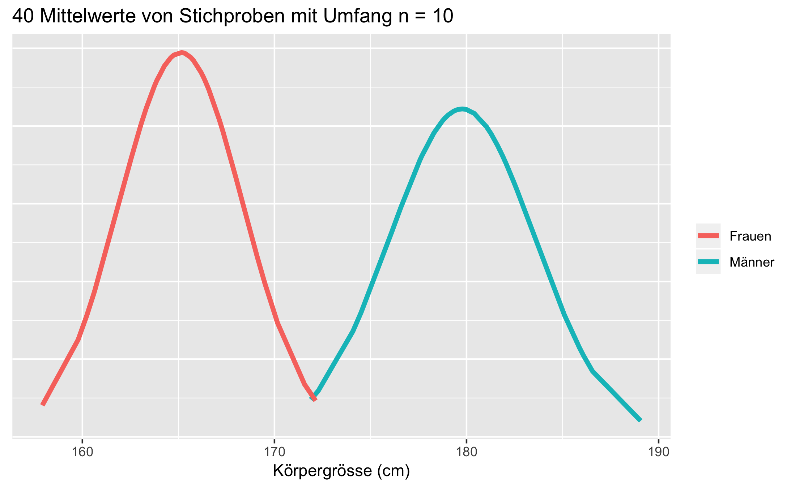{fig-align="center" width=100%}

- Theoretische Power: 0.841
- True (+): 35 / False (-): 5
- $(1-\beta) = \frac{35}{40} = 0.875$

:::

::::

## Beispiel Fehler 2. Art n = 20 {.smaller}

:::: {.columns}

::: {.column width="50%"}

{fig-align="center" width=80%}
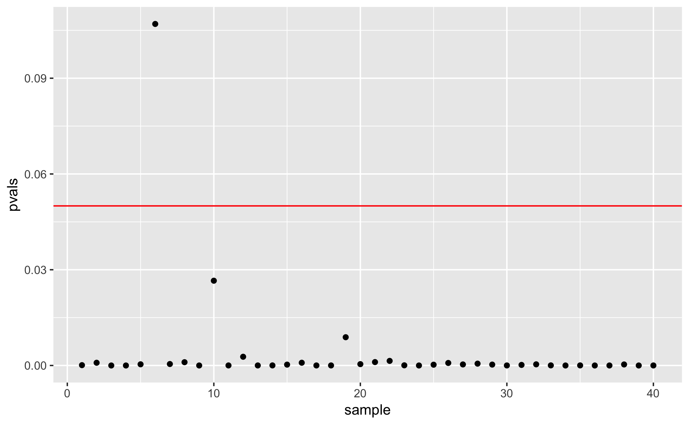{fig-align="center" width=80%}
:::

::: {.column width="50%"}

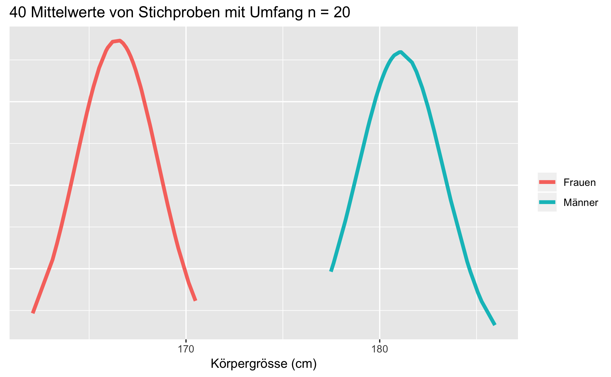{fig-align="center" width=100%}

- Theoretische Power: 0.991
- True (+): 39 / False (-): 1
- $(1-\beta) = \frac{39}{40} = 0.975$

:::

::::

## Beispiel Fehler 1. Art {.smaller}

:::: {.columns}

::: {.column width="50%"}

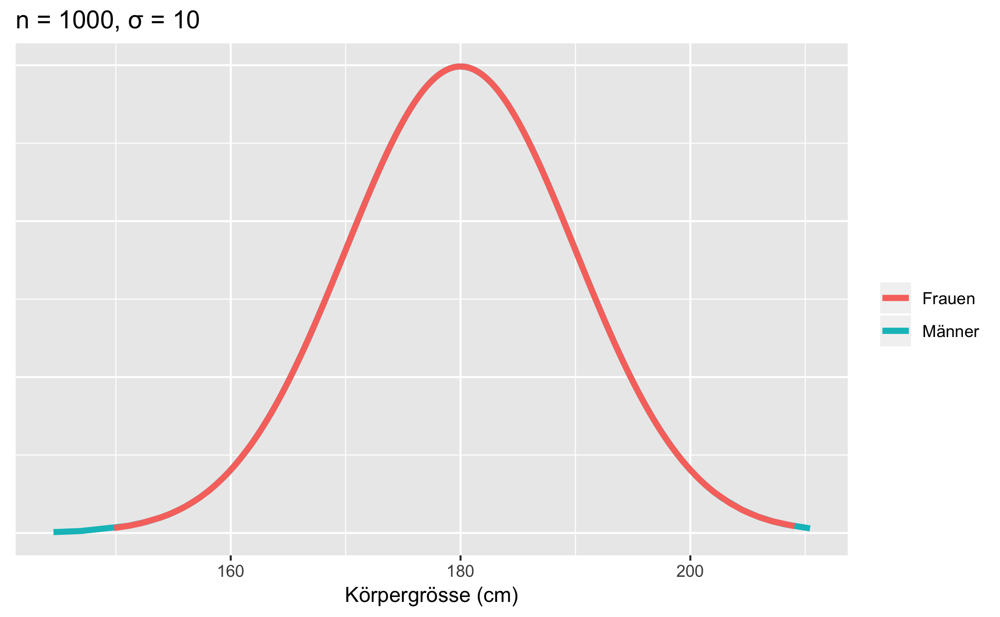{fig-align="center" width=80%}
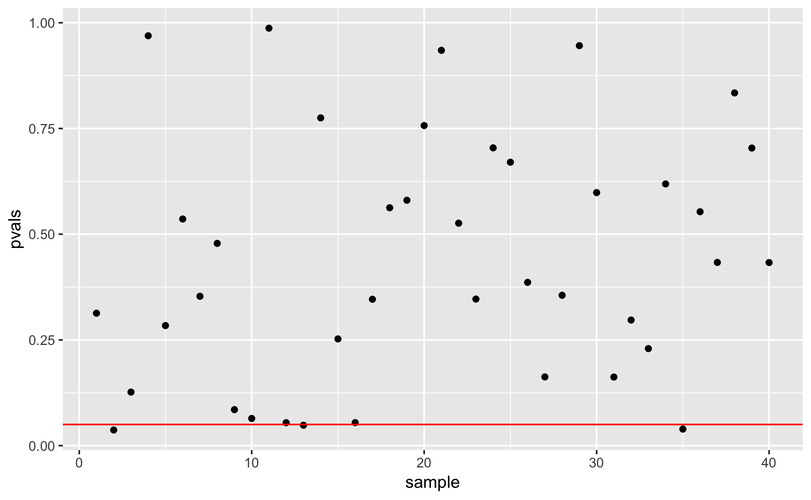{fig-align="center" width=80%}
:::

::: {.column width="50%"}

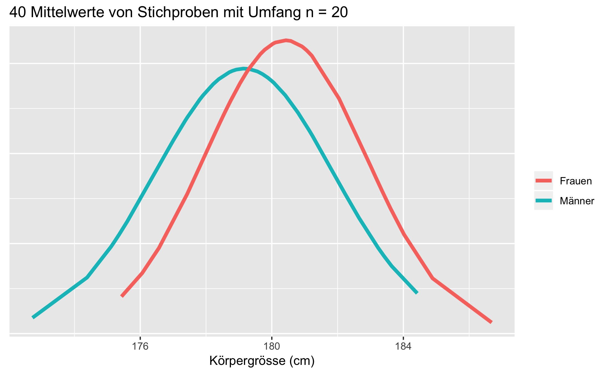{fig-align="center" width=100%}

- Signifikanzniveau $\alpha = 0.05$
- True (-): 38 / False (+): 2
- $\alpha = \frac{2}{40} = 0.05$

:::

::::

## Bestimmen des Stichprobenumfangs {.smaller}

:::: {.columns}

::: {.column width="50%"}

{fig-align="center" width=70%}

Effektstärke (Cohen's d)

$$
d=\frac{\bar{x}_1-\bar{x}_2}{s}
$$

- Klein: 0.2 bis 0.3
- Mittel: 0.5 bis 0.8
- Stark: $>$ 0.8
:::

::: {.column width="50%"}

- Festlegen von...
  - Signifikanzniveau
  - Power. Üblich sind 0.8 oder 0.9.
  - Effektstärke. Oft 0.5.
- Berechnen der Stichprobengrösse um den Effekt mit der gewünschten Power bei gegebenem Signifikanzniveau nachzuweisen.

Effektstärke für Beispiel
$$
d = \frac{180-166}{10} = 1.4
$$

:::

::::

## Beispiel Körpergrösse Entscheid {.smaller}

```{r}
#| fig.align: "center"
plt 
```

```{r}
outdf |>
  kableExtra::kable()
```

- Da $p < 0.05$ ist, verwerfen wir die Nullhypothese, dass es auf dem Signifikanzniveau von 5% keinen Unterschied der Körpergrösse zwischen Männern und Frauen gibt.
- Wir könnten einen Fehler 1. Art begehen und fälschlicherweise zum Schluss kommen, dass sich die Körpergrösse zwischen Männern und Frauen unterscheidet.

## Konfidenzintervall {.smaller}

```{r}
#| fig.align: "center"
plt 
```

```{r}
outdf |>
  kableExtra::kable()
```

- Konfidenzintervalle: Bereich plausibler Werte für einen Populationsparameter
- Im Beispiel für die mittlere Differenz der Körpergrösse zwischen Männern und Frauen
- Null ist nicht im Vertrauensintervall drin: eine Differenz von Null ist nicht plausibel: $H_0$ wird verworfen.
- Selber Schluss wie mit dem p-Wert, aber mit wertvoller Zusatzinformation

## Konfidenzintervall (cont.) {.smaller}

```{r}
#| fig.align: "center"
plt 
```

```{r}
outdf |>
  kableExtra::kable()
```

- Der Unterschied der Körpergrösse zwischen Frauen und Männern beträgt mit 95% Vertrauenswahrscheinlichkeit zwischen 11.01 cm und 15.78 cm.
- Wir bekommen aus dem Vertrauensintervall Informationen zur Richtung und der Grösse des Effekts.
- Dies lässt die Interpretation zu, ob ein signifikanter Unterschied auch klinisch relevant ist.

## Fehlinterpretationen Hypothesentests {.smaller}

:::: {.columns}

::: {.column width="30%"}

{fig-align="center" width=100%}
:::

::: {.column width="70%"}

- Hypothesentests kommen zu einem binären Entscheid, der entweder wahr oder falsch sein kann.
- Ablehnung der Nullhypothese heisst nicht, dass die Alternativhypothese wahr ist (kein Beweisen!)
- Nicht-Ablehnung der Nullhypothese heisst nicht, dass diese wahr ist.
- Hypothesen können nur widerlegt, aber nicht bewiesen werden (Prinzip der Falsifikation)
- Hypothesen müssen sich bewähren und sind so lange gültig, bis Evidenz **dagegen** gefunden wird.
:::

::::

::: footer

- [Karl Popper 1959 *Logik der Forschung*](https://de.wikipedia.org/wiki/Logik_der_Forschung) 

:::

## Wann welchen Test?

{fig-align="center" width=100%}

## Zusammenfassung {.smaller}

:::: {.columns}

::: {.column width="30%"}

{fig-align="center" width=100%}
:::

::: {.column width="70%"}

- Wir haben gesehen wie ein statistischer Test abläuft. 
- Mit dem p-Wert quantifizieren wir Evidenz gegen die Nullhypothese.
- Aussagekräftiger als p-Werte und Signifikanz sind Konfidenzintervalle.
- Hypothesentests haben nach wie vor eine grosse Bedeutung in der wissenschaftlichen Literatur.
- Darum muss man das Prinzip und die Begriffe des statistischen Testens verstehen.
:::

::::

